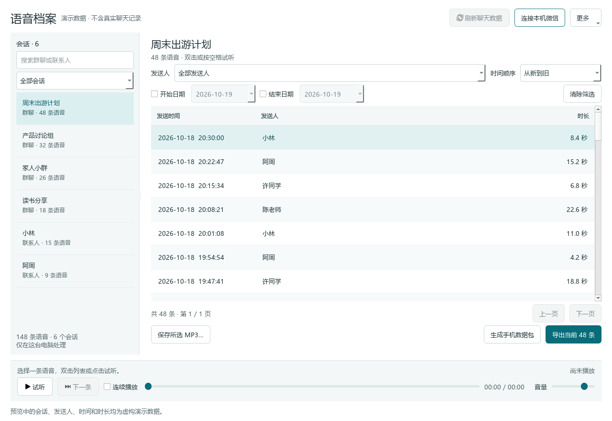
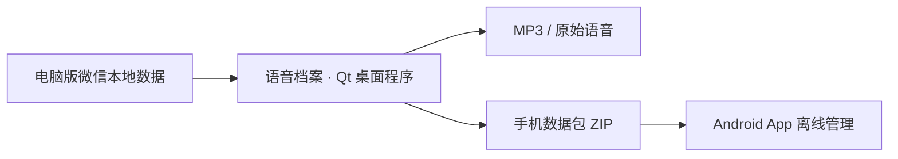

<h1>语音档案 · WeChat Voice</h1>

<strong>让重要的声音，留在微信之外。</strong>

提取微信原始语音，保存为 MP3。 按会话整理，按发送人查找，按时间回听。

  
  
  
  

  <a href="https://github.com/LittleParis/WeChat-Voice/releases/download/v0.4.1/VoiceKeep-0.4.1-windows-x64.exe"><strong>下载 Windows 程序</strong></a>
  &nbsp; · &nbsp;
  <a href="docs/getting-started.md">详细使用指南</a>
  &nbsp; · &nbsp;
  <a href="https://github.com/LittleParis/WeChat-Voice/issues">反馈问题</a>

双击 EXE 即可使用 · 无需安装 Python、Qt 或 Git

真实程序界面；截图中的会话、发送人、时间和时长均为虚构演示数据。

## 把声音留下来，把查找变简单

家人的叮嘱、朋友的留言、讨论里的关键片段——有些语音，值得单独保存。

**语音档案**将电脑版微信中已有的原始语音，整理为可以独立播放、复制和保存的音频文件。先选一个会话，再找到想要的那个人、那一天，试听后导出。

| 你想做的事 | 语音档案如何帮你 |
| --- | --- |
| 保存一条重要语音 | 试听确认，选择位置，保存为 MP3 |
| 从群聊里找某个人的发言 | 进入群聊，按发送人筛选，再按时间排序 |
| 整理一段时间的语音 | 选择起止日期，批量导出全部筛选结果 |
| 区分不同联系人和群聊 | 会话侧栏分类展示，支持搜索 |
| 连续回听一组语音 | 暂停、拖动进度、调节音量，或开启连续播放 |
| 带到手机上继续整理 | 生成 ZIP 数据包，在 Android App 中离线导入、筛选和保存 |

**直接提取原始语音，无需在微信中逐条播放，也不使用录音。**

## 三步，先保存一条语音

### 1. 下载并打开

从 [v0.4.1 发布页](https://github.com/LittleParis/WeChat-Voice/releases/tag/v0.4.1) 下载 **`VoiceKeep-0.4.1-windows-x64.exe`**，放到本机文件夹后双击。

- 选择 `.exe` 文件；`Source code` 是源码包。
- 首次启动需要等待依赖解包，随后直接进入 Qt 窗口。
- 更新时先退出旧版，再运行新版，已有配置和缓存会继续使用。

### 2. 连接本机微信

先登录电脑版微信，在程序右上角点击 **“连接本机微信”**：

1. 点击 **“自动查找”**，或用 **“选择文件夹…”** 选择聊天数据目录。
2. 检查目录并选择账号。
3. 点击 **“连接并读取语音”**，按窗口提示完成连接。

目录示例：`D:\xwechat_files`。请选择聊天数据目录，不要选择微信安装目录或 `Backup` 文件夹。

> 首次获取密钥可能需要从微信托盘菜单退出，再手动重新打开并登录。程序会显示操作提示，你无需手动查找或填写密钥。[查看首次连接步骤 →](docs/getting-started.md#首次连接微信)

### 3. 找到、试听、保存

在左侧选择群聊或联系人，按发送人和日期筛选，双击一条语音试听，再点击 **“保存所选 MP3…”**。

想一次保存更多？点击 **“导出当前 N 条”**，导出范围包含全部筛选结果，涵盖后续分页。完成后点击 **“打开结果文件夹”**。

| 快捷操作 | 用法 |
| --- | --- |
| 搜索会话 | `Ctrl + F` |
| 播放 / 暂停 | 在语音列表中按 `空格` |
| 试听所选语音 | 在语音列表中按 `Enter`，或双击 |
| 减少滚动动画 | 右上角 **更多 → 减少动态效果** |

## 在电脑提取，在手机继续听

**只需要听语音，直接把 MP3 传到手机即可。**

需要在手机上保留会话、发送人和时间信息时，再使用 Android App：电脑点击“生成手机数据包”，把完整 ZIP 传到手机，在 App 中导入，无需解压。App 支持离线筛选、前台连续播放、多选保存，以及重复导入时跳过已有内容。

手机保存的 MP3 位于 `Music/VoiceKeep/`。目前 Android App 提供源码构建方式，[安装与导入步骤见指南](docs/getting-started.md#可选在-android-app-中整理语音)。

## 使用前，确认这几件事

| 项目 | 当前支持情况 |
| --- | --- |
| 桌面系统 | Windows 10 / 11，64 位 |
| 微信数据 | 微信 4.x 的 `xwechat_files / db_storage` 结构 |
| 已验证的电脑版微信 | 4.1.13.65；其他版本需验证兼容性 |
| 原始音频 | 已验证 SILK 提取与 MP3 转换 |
| Android App | 最低 Android 10，已在 Android 16 真机验证 |
| 手机端使用方式 | 导入电脑生成的数据包后离线管理 |

当前不支持 macOS / Linux 桌面提取、旧版 `WeChat Files` 数据结构、AMR 解码或新式 RMFH 官方备份容器的直接解密。

**原始语音提取仍需电脑。** Android App 目前不能独立读取未 Root 手机的微信私有聊天数据；微信登录授权也不提供聊天记录访问能力。

## 数据留在本机

语音提取、数据库处理和 MP3 转换在本机完成。程序不需要将聊天数据库或音频上传到云端，发布包中不附带个人聊天记录、密钥或账号配置。

| 内容 | Windows EXE 默认位置 |
| --- | --- |
| 连接配置、密钥、数据副本与音频缓存 | `%LOCALAPPDATA%\VoiceKeep\.private` |
| 批量导出结果、手机数据包 | `%LOCALAPPDATA%\VoiceKeep\exports` |
| 单条 MP3 | 系统保存窗口中由你选择的位置 |

手机数据包包含音频和会话元数据；`.private` 内包含敏感数据。反馈问题时请只提供复现步骤、版本和去除个人信息后的报错。

## 常见问题

<strong>记录只在手机上，能导出吗？</strong>

先使用微信官方的“导出到电脑”，由同账号电脑版微信接收，再通过本工具提取。具体入口以当前微信版本为准。

“备份到电脑”与进入电脑端本地会话数据库是两条不同路径。本工具目前读取后者，不能直接解密新式 RMFH 备份容器。消息记录进入电脑后，也仍需确认对应原始媒体实际存在。

<strong>自己发送的语音也能保存吗？为什么有些语音找不到？</strong>

可以提取自己和他人发送的语音，前提是电脑端保存了对应原始媒体。发送者可能显示为备注、昵称或账号，不一定标成“我”。

找不到时，先清除发送人和日期筛选。刚接收的内容可点击“刷新聊天数据”；只有手机有记录，或电脑数据库只有消息、没有音频时，仍无法直接导出。

<strong>程序包为什么约 100 MB？需要安装环境吗？</strong>

EXE 内置 Python、Qt、音频和数据库处理依赖，普通用户无需另装 Python、Qt、Git 或输入启动命令。首次启动会解包依赖，需等待片刻。

当前是 Windows x64 未签名试用版。[发布页](https://github.com/LittleParis/WeChat-Voice/releases/tag/v0.4.1)附带 `SHA256SUMS.txt`，可核对文件完整性。

<strong>更新程序或刷新数据，会清空原来的内容吗？</strong>

更新 EXE 会沿用原数据目录。连接失败或取消时，之前成功准备的数据会保留。电脑微信新增语音后，点击“刷新聊天数据”更新；列表目前不是实时监听。

刷新会生成独立数据副本，旧副本暂不自动清理，请留意磁盘空间。

更多连接、导出、手机导入与故障处理，见 [完整使用指南](docs/getting-started.md)。

## 开发与贡献

项目使用 **Python + PySide6 / Qt Widgets** 提供原生桌面界面，保留可选本机 Web 入口；Android App 管理导入后的离线语音。

| 想了解什么 | 从这里开始 |
| --- | --- |
| 源码安装、固定版本依赖、启动命令 | [源码运行指南](docs/getting-started.md#开发者从源码运行) |
| EXE 构建、Qt 交互与性能验证 | [Windows 桌面版说明](docs/windows-exe.md) |
| 目录、账号与密钥连接流程 | [连接流程说明](docs/connection.md) |
| Android 导入、播放与保存验证 | [Android 测试说明](docs/testing.md) |
| 依赖来源与许可证 | [第三方说明](THIRD_PARTY.md) |

v0.4.1 已通过 **68 项源码回归**，包含后台慢查询、快速切换、播放、分页与多尺寸布局测试；独立 EXE 也已验证真实语音播放、MP3 导出和手机数据包。测试使用合成数据，不随源码提供私人聊天样本。

欢迎通过 [Issues](https://github.com/LittleParis/WeChat-Voice/issues) 反馈问题、讨论需求，或提交改进。

感谢 [wechat-decrypt](https://github.com/freanocank/wechat-decrypt) 及 Qt、音频处理相关依赖提供的基础能力，来源与授权详见 [THIRD_PARTY.md](THIRD_PARTY.md)。

---

如果它帮你留住了一段重要的声音，欢迎点一个 Star，让更多人找到它。

